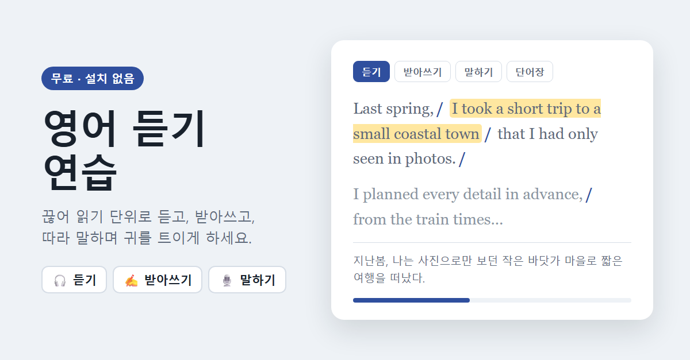

# 영어 듣기 연습

끊어 읽기 단위로 영어를 **듣고, 받아쓰고, 따라 말하는** 연습을 하는 웹 앱입니다.
설치나 가입 없이 브라우저에서 바로 쓸 수 있고, 학습 기록은 내 브라우저에만 저장됩니다.

👉 **바로 쓰기: https://taeyoonkim-ds.github.io/listening-practice/**



## 주요 기능

- **듣기**: 브라우저 음성 합성(TTS)으로 지문을 끊어 읽기 단위로 들려줍니다. 속도, 목소리, 끊어 읽기 사이 쉬는 시간을 조절할 수 있고, 본문을 가리고 듣거나 한 문장을 반복해서 들을 수 있습니다.
- **받아쓰기**: 한 문장씩 듣고 입력하면 틀린 단어를 표시해 줍니다. 천천히 듣기와 힌트를 쓸 수 있습니다.
- **말하기**: 문장을 따라 읽으면 브라우저 음성 인식이 알아들은 문장을 본문과 비교해 채점하고, 내 녹음과 원어민 음성을 번갈아 들어 볼 수 있습니다.
- **단어장**: 본문에서 단어를 드래그(휴대폰은 길게 누르기)하면 뜻과 함께 저장되고, 단어 퀴즈로 복습할 수 있습니다.
- **해석**: 문장에 마우스를 올리거나 탭하면 한국어 해석이 보이고, 해석 보기를 켜면 문단마다 해석이 나옵니다.
- **보관함**: 원하는 영어 지문을 붙여넣어 여러 개 보관하고, 파일로 내보내거나 불러올 수 있습니다.
- **오늘의 뉴스**: 위키백과 영어판의 'In the news'와 오늘의 글로 매일 새 지문을 만들어 줍니다.

## 사용법

1. 위 주소를 Chrome, Edge, Safari에서 엽니다.
2. 기본 예문(여행 이야기)으로 바로 시작하거나, **보관함 → 새 지문 추가**에서 연습할 영어 지문을 붙여넣습니다.
   - 끊어 읽을 곳에 `/`를 넣으면 그 단위로 끊어서 읽어 줍니다. `/`가 없으면 쉼표 등을 기준으로 자동으로 나눕니다.
   - 해석 칸에 문단마다 빈 줄로 구분한 한국어 해석을 넣으면 각 문단 아래에 표시됩니다.
3. 추천 순서: 본문 가리고 듣기 → 받아쓰기 → 말하기(섀도잉) → 단어 퀴즈 → 해석 확인

### 키보드 단축키

| 키 | 동작 |
| --- | --- |
| `1`~`4` | 듣기 / 받아쓰기 / 말하기 / 단어장 탭 전환 |
| `Space` | 재생·일시정지 (받아쓰기: 듣기, 말하기: 녹음) |
| `←` `→` | 이전·다음 문장 |
| `R` | 다시 듣기 (말하기: 원어민 음성) |
| `S` / `H` | 받아쓰기: 천천히 듣기 / 힌트 |
| `M` | 말하기: 내 녹음 듣기 |
| `Esc` | 전체 정지 |

휴대폰에서는 좌우로 스와이프해 문장을 넘길 수 있습니다.

## 개인정보 안내

- **저장 위치**: 지문, 학습 기록, 녹음, 단어장, 설정은 모두 사용 중인 브라우저의 저장소(localStorage, IndexedDB)에만 저장됩니다. 이 앱은 별도 서버나 계정이 없고, 개발자가 이 데이터를 수집하지 않습니다.
- **백업**: 브라우저 데이터를 지우거나 다른 기기·브라우저로 옮기면 기록이 보이지 않습니다. 보관함의 **파일로 내보내기**로 백업해 두세요.
- **말하기 채점**: 브라우저 내장 음성 인식(Web Speech API)을 사용합니다. 브라우저에 따라 녹음된 음성이 브라우저 제조사(Google, Apple, Microsoft 등)의 서버로 전송되어 처리될 수 있습니다.
- **외부 서비스**: 아래 기능을 쓸 때는 해당 문장이나 단어가 외부 무료 서비스로 전송됩니다. **오늘의 뉴스 자동 받기**(기본 켜짐)가 켜져 있으면 매일 처음 열 때 사용자 조작 없이 위키백과 지문을 받아 오면서 번역·단어 서비스에도 자동으로 접속합니다. 이때 보내는 것은 위키백과 글이지만, 접속 IP는 각 서비스에 전달됩니다. 보관함에서 끌 수 있습니다.
  - 문장 해석: Google 번역, MyMemory
  - 단어 정보: Wiktionary(뜻), Datamuse(빈도), Tatoeba(예문)
  - 오늘의 뉴스: Wikimedia API
- **글꼴**: Google Fonts에서 글꼴을 불러옵니다.

## 권장 환경

Chrome, Edge, Safari 최신 버전을 권장합니다. 음성 읽기와 음성 인식 지원은 브라우저와 운영체제마다 다르며, Firefox에서는 말하기 채점이 동작하지 않을 수 있습니다.

## 직접 실행하기

빌드 과정이 없는 단일 HTML 파일입니다. 저장소를 내려받아 `index.html`을 브라우저로 열면 됩니다.
음성 인식은 보안 연결(HTTPS 또는 localhost)에서만 동작하므로, 말하기까지 확인하려면 로컬 서버로 여는 것이 좋습니다.

```sh
python -m http.server 8000
# http://localhost:8000 접속
```

## 기본 예문

기본으로 들어 있는 영어 지문과 한국어 해석은 이 앱을 위해 직접 쓴 글입니다.
